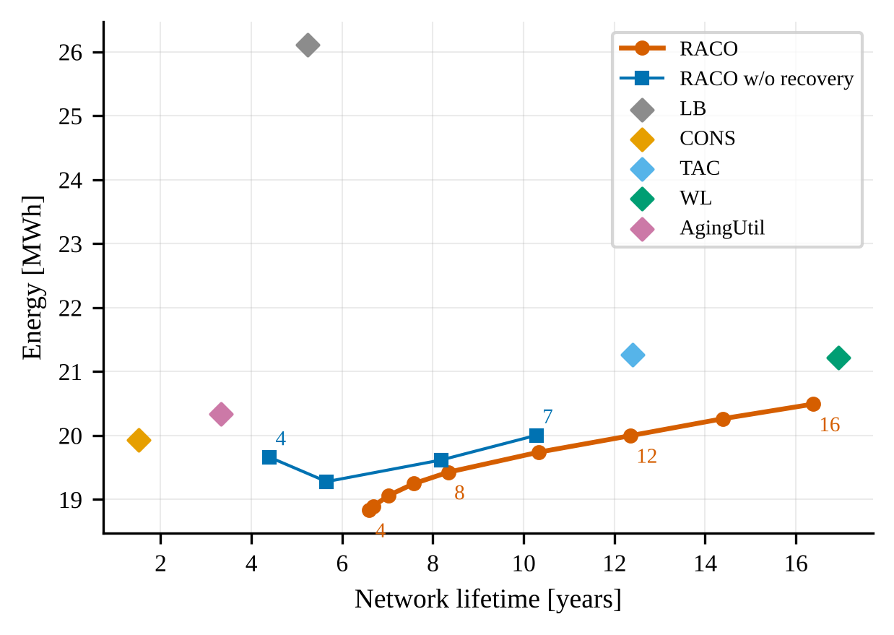

# RACO: Recovery-Aware Aging and Energy Co-Optimization for Lifetime-Guaranteed Task Scheduling in Fog Computing

This repository contains the simulator, the scheduler, the baselines, the experiment scripts and the complete results of the paper

> F. Rafiei, M. Ramezanpour, *RACO: Recovery-Aware Aging and Energy Co-Optimization for Lifetime-Guaranteed Task Scheduling in Fog Computing*, manuscript under review, 2026.

RACO is an online scheduler for fog computing that minimizes the energy consumption of the fog layer while guaranteeing that every fog node reaches a prescribed hardware lifetime. It combines a two-component NBTI aging model with permanent and recoverable degradation, the coupling between power, junction temperature, aging and adaptive voltage scaling, and the ambient temperature of every installation site, and it schedules the active/deep-sleep modes of the nodes and the dispatching of the demand with Lyapunov drift-plus-penalty optimization.

## Key ideas

- **Equivalent stress time.** Time-varying thermal and electrical stress is converted into an equivalent stress time that accumulates additively, which turns the non-linear lifetime constraint into a budget.
- **Recovery weighting.** Every frame of operation is weighted by the recoverable state of the node, so that short deep-sleep periods earn lifetime credit.
- **Aging virtual queues.** The budget of every node becomes a Lyapunov virtual queue that acts as a node-specific price of aging; rotating consolidation emerges from these prices.
- **Deterministic lifetime guarantee.** A safety rule bounds the virtual queues and guarantees the target lifetime of every node for any demand and weather sequence; demand that the unprotected nodes cannot serve is forwarded to the cloud.

## Main results

Mean over eight independent replications, six-year horizon, 20 heterogeneous fog nodes, target lifetime L = 5 years, load level 0.4. Energy in MWh, network lifetime (first node failure) in years, number of nodes that fail before L, SLA violations in %, lifecycle carbon (operational + embodied) in t CO2e.

**Azure Functions trace with the measured weather of Tehran** (`results/azure_weather`)

| Method | Energy | Network lifetime | Failed before L | SLA violations | Lifecycle carbon |
|---|---|---|---|---|---|
| LB | 26.11 | 5.23 | 0.1 | 0.00 | 20.19 |
| CONS | 19.93 | 1.51 | 15.4 | 2.94 | 18.91 |
| TAC | 21.27 | 12.40 | 0.0 | 3.24 | 16.72 |
| WL | 21.22 | 16.93 | 0.0 | 2.58 | 16.69 |
| AgingUtil | 20.34 | 3.32 | 9.4 | 0.05 | 16.79 |
| **RACO** | **18.95** | 6.64 | **0.0** | 0.10 | **15.48** |

**Alibaba cluster trace with the measured weather of Tehran** (`results/alibaba_weather`)

| Method | Energy | Network lifetime | Failed before L | SLA violations | Lifecycle carbon |
|---|---|---|---|---|---|
| LB | 26.06 | 5.15 | 0.2 | 0.00 | 20.20 |
| CONS | 20.09 | 1.58 | 15.4 | 3.63 | 18.91 |
| TAC | 21.57 | 14.46 | 0.0 | 2.76 | 16.90 |
| WL | 21.54 | 16.41 | 0.0 | 2.29 | 16.88 |
| AgingUtil | 20.52 | 3.50 | 8.8 | 0.23 | 16.74 |
| **RACO** | **19.33** | 6.66 | **0.0** | 0.37 | **15.66** |

Across the four scenarios, RACO consumes 3.8–5.3% less energy than energy-aware consolidation (CONS), 5.6–6.8% less than a utilization-based aging-aware Lyapunov scheduler (AgingUtil) and 10–11% less than thermal-aware (TAC) and wear-leveling (WL) consolidation, and it reduces the lifecycle carbon by 16–18% with respect to CONS. All differences are significant (paired t-test p ≤ 0.004, Wilcoxon signed-rank test p = 0.0078). RACO spends no energy on longevity beyond the target; when the target is raised, it reaches the lifetime of WL with about 3% less energy and one third of its SLA violations. Adding the safety rule to the utilization-based baseline (AgingUtil-S) does not prevent its failures, and with milder aging (reference lifetime of 7 or 10 years instead of 3.5) RACO remains the most energy-efficient method and the only energy-oriented one without node failures.

<p align="center"></p>

## Repository structure

```
RACO/
├── raco/                       core package
│   ├── config.py               scenario, device and algorithm parameters
│   ├── inputs.py               workload and ambient-temperature generation / trace loading
│   ├── physics.py              NBTI aging, thermal and aging-aware power models
│   ├── simulator.py            frame-level discrete-time fog simulator and metrics
│   ├── policies.py             RACO, ablations and baselines (LB, CONS, TAC, WL, AgingUtil)
│   ├── experiments.py          experiment suites, parallel execution and result caching
│   ├── plots.py                figures of every scenario (PNG and PDF)
│   └── excel.py                results workbook
├── scripts/                    preparation of the public traces and weather data
├── run_all.py                  runs one scenario: all experiments, figures and workbook
├── run_scenarios.py            runs the four evaluation scenarios of the paper
├── energy_breakdown.py         energy breakdown of the main methods
├── safety_statistics.py        safety-rule statistics versus V
├── results/                    results of the paper (one folder per scenario)
│   ├── azure/                  results_RACO.xlsx + figures/
│   ├── alibaba/
│   ├── azure_weather/
│   └── alibaba_weather/
├── paper_figures/              Figs. 1–12 of the paper and the scripts that draw Figs. 2–12
└── data/                       input traces (not distributed, see below)
```

## Installation

Python 3.9 or newer is required. No GPU is needed.

```bash
git clone https://github.com/mauresearch/RACO.git
cd RACO
pip install -r requirements.txt
```

## Data

The simulator runs out of the box with a synthetic workload and synthetic climates. The evaluation in the paper uses the following public datasets, which are not redistributed in this repository.

| Dataset | Source | Preparation |
|---|---|---|
| Azure Functions Trace 2019 | [Azure Public Dataset](https://github.com/Azure/AzurePublicDataset/blob/master/AzureFunctionsDataset2019.md) | `python scripts/prepare_azure_functions.py --src <archive> --out data/azure_functions_iot.csv --iot-only` |
| Alibaba Cluster Trace v2018 (`machine_usage`) | [alibaba/clusterdata](https://github.com/alibaba/clusterdata/blob/master/cluster-trace-v2018/trace_2018.md) | `python scripts/prepare_alibaba.py --src <machine_usage.tar.gz> --out data/alibaba_cpu.csv` |
| Hourly 2-m air temperature 2019–2023 (Tehran, Bandar Abbas, Tabriz, Rasht) | [Open-Meteo historical weather API](https://open-meteo.com/en/docs/historical-weather-api) | `python scripts/download_weather.py --out data` |

Both preparation scripts read the downloaded archives directly; extraction is not required. Any other workload can be used as a CSV file with two columns, `timestamp,value`, at an arbitrary sampling interval.

## Usage

Quick run with synthetic inputs (a few minutes):

```bash
python run_all.py --mode quick
```

One scenario with a real workload and measured weather:

```bash
python run_all.py --mode full --workload-csv data/azure_functions_iot.csv --weather-dir data --out results/azure_weather
```

All four scenarios of the paper (Azure, Alibaba, and both with measured weather):

```bash
python run_scenarios.py
```

Energy breakdown (base, leakage, dynamic, deep sleep, wake-up) of the main methods for one scenario:

```bash
python energy_breakdown.py --workload-csv data/azure_functions_iot.csv --out results/azure
```

Safety-rule statistics of RACO versus the Lyapunov parameter V:

```bash
python safety_statistics.py --workload-csv data/azure_functions_iot.csv --out results/azure
```

Figures 2–12 of the paper (Figs. 2–5 and 8–12 from the results workbooks, Figs. 6–7 with one short re-simulation):

```bash
python paper_figures/make_figures.py
python paper_figures/make_extra_figures.py
```

Main options of `run_all.py`:

| Option | Description |
|---|---|
| `--mode quick\|full` | `full` uses 8 independent replications for the main and ablation experiments and 3 for the sensitivity sweeps |
| `--jobs N` | number of parallel worker processes (default: all cores) |
| `--workload-csv FILE` | workload trace (`timestamp,value`) |
| `--weather-dir DIR` | folder with `weather_<City>.csv` files |
| `--forecast last\|max3\|hybrid` | demand forecast used to size the active set (default `hybrid`) |
| `--delta X` | capacity head-room over the forecast (default 0.05) |
| `--years Y`, `--frame-h H` | simulated horizon and frame length |
| `--plots-only` | redraw figures and workbook from cached results |

Every simulation run is cached in `<out>/raw/` under a fingerprint of the configuration, so interrupted runs resume automatically and changed settings never reuse stale results. A full scenario takes about 30 minutes on 8 cores.

## Experiments and outputs

Each scenario produces `results_RACO.xlsx`, which contains every number behind every figure (per-replication results, summaries, statistical tests, sensitivity sweeps including the aging calibration `Sens_Lref`, the safety-rule baseline `Baseline_Safety`, solver gap, scalability, per-node results and daily time series), and the following figures in PNG and PDF format.

| Figure | Content |
|---|---|
| `fig01` | workload and ambient-temperature inputs |
| `fig02` | threshold-voltage shift of every node over time |
| `fig03` | fraction of nodes alive over time |
| `fig04` | main comparison: energy, lifetime, SLA violations, aging Gini index, lifecycle carbon |
| `fig05` | energy–lifetime trade-off (target-lifetime sweep) |
| `fig06` | active/deep-sleep schedule of one week |
| `fig07` | ablation study |
| `fig08` | Lyapunov parameter V |
| `fig09` | recovery time constant |
| `fig10` | climate |
| `fig11` | load level |
| `fig12` | junction temperature versus node lifetime |
| `fig13` | per-frame optimality gap of the solver |
| `fig14` | decision time versus network size |
| `fig15` | lifecycle carbon |
| `fig16` | adaptive versus fixed supply voltage |
| `fig17` | aging virtual queues and stress-time budget |
| `fig18` | NBTI time exponent |
| `fig19` | capacity head-room |

Compared methods:

| Name | Description |
|---|---|
| `LB` | load balancing, all nodes active |
| `CONS` | energy-aware consolidation (most energy-efficient nodes first) |
| `TAC` | thermal-aware consolidation (coolest nodes first) |
| `WL` | wear-leveling consolidation (least-aged nodes first) |
| `AgingUtil` | Lyapunov scheduling with a utilization-based aging proxy |
| `AgingUtil-S` | AgingUtil with the safety rule of RACO |
| `RACO` | proposed method |
| `RACO-noRec`, `RACO-noTherm`, `RACO-noSafety`, `EnergyOpt` | ablations without recovery weighting, thermal awareness, safety rule, or aging term |

## Model parameters

All device, thermal, workload and algorithm parameters are defined in `raco/config.py` and recorded in the `Config` sheet of every results workbook. Physical parameters are defaults within the ranges reported in the NBTI and edge-hardware literature; the sensitivity experiments quantify their influence.

## Citation

If you use this code or the results, please cite:

```bibtex
@misc{rafiei2026raco,
  title  = {{RACO}: Recovery-Aware Aging and Energy Co-Optimization for Lifetime-Guaranteed Task Scheduling in Fog Computing},
  author = {Rafiei, Fatemeh and Ramezanpour, Mohammadreza},
  year   = {2026},
  note   = {Manuscript under review. Code and data: https://github.com/mauresearch/RACO}
}
```

The reference will be updated once the paper is published.

## Authors

- Fatemeh Rafiei, Department of Computer Engineering, Mo. C., Islamic Azad University, Isfahan, Iran
- Mohammadreza Ramezanpour (corresponding author, 1263560441@iau.ir), Department of Computer Engineering, Mo. C., Islamic Azad University, Isfahan, Iran

## License

This project is released under the MIT License. The workload traces and weather data are subject to the licenses of their respective providers.
